# strapi-plugin-translate

AI-powered translation of localized Strapi v5 entries via [OpenRouter](https://openrouter.ai) LLMs. Walks the schema of a content type, sends every translatable string through an LLM in concurrent chunks, and writes the result back into the target locale of the same document.

## Features

- **Document Action** in the Edit View — one click to translate the current entry into one or many target locales.
- **Translate saved changes** — after saving an eligible source edit, select modules and target languages, then review a preview of just those changes. Unchanged target copy and component IDs are preserved.
- **Localized collection links** — changed modules use the linked item's existing target-language version. Optionally include pending linked-item changes or create missing localized items, with separate previews.
- **Schema-aware walker** — handles components, dynamic zones, repeatable components, Strapi blocks (rich-text JSON), and CKEditor HTML.
- **Format-aware prompts** — preserves Markdown, HTML, and Strapi-blocks structure exactly; translates only human-readable text nodes.
- **Multi-locale batches** — pick several targets at once; they're processed sequentially with a live progress bar.
- **Cancellable jobs** — abort in-flight translations from the UI.
- **Voice & glossary** — admin-editable tonality instructions, plus a per-locale glossary and a preserve-exactly list (brand/place names).
- **Stale-relation preflight** — verifies relations/media exist before burning LLM tokens; surfaces dangling refs as warnings instead of aborting.
- **Schema-constraint aware** — field `maxLength`/`minLength` limits are baked into the prompt up front, and if the save still fails Strapi validation (e.g. a translated title outgrew its limit), the exact validation message is fed back to the AI to regenerate the field — same meaning, shorter wording — and the save is retried automatically. Repairs are surfaced as warnings.
- **OpenRouter** — uses OpenRouter's OpenAI-compatible API with structured JSON outputs and built-in model fallback.

## Requirements

- Strapi v5.57 or later (`@strapi/strapi` ^5.57.0)
- Node.js 22.12+ (development and integration checks use Node 24)
- An [OpenRouter](https://openrouter.ai) API key
- The `@strapi/i18n` plugin enabled (this plugin reads locales from it)

The admin dependencies use the latest compatible React 18, React Router 6, and React Intl 7 releases. Strapi's admin requires React 18 and React Router 6; React Intl 8+ uses a separate context that cannot consume Strapi's existing translation provider. TypeScript stays on 5 to satisfy React Intl 7's declared peer range. Other direct dependencies use their latest stable releases.

## Installation

```bash
npm install @wolvesdotink/strapi-plugin-translate
# or
yarn add @wolvesdotink/strapi-plugin-translate
# or
bun add @wolvesdotink/strapi-plugin-translate
```

The plugin id is `translate` (unchanged by the package scope), so it is enabled
under the `translate` key in `config/plugins.js` — see [Configuration](#configuration).

## Configuration

Enable and configure the plugin in `config/plugins.js`:

```js
module.exports = ({ env }) => ({
  translate: {
    enabled: true,
    config: {
      provider: "openrouter",
      providerOptions: {
        apiKey: env("OPENROUTER_API_KEY"),
        model: env("OPENROUTER_MODEL", "anthropic/claude-sonnet-4.6"),
        // OpenRouter required attribution headers
        siteUrl: env("PUBLIC_URL", "https://your-site.example"),
        siteName: "Your Site CMS",
        // Hard cap for safety. Lower this if you see finish_reason=length truncation.
        maxOutputTokens: 8000,
        // Optional fallback models if the primary is unavailable (OpenRouter feature)
        fallbackModels: [],
      },
      settings: {
        // Source locale used when the request doesn't specify one
        sourceLocale: "de",
        // Voice/tone steering injected into the system prompt
        voice:
          "Warm, inviting copy. Keep tone natural to the target language — " +
          "do not translate literally. Maintain identical HTML structure and URLs.",
        // Optional path to a default glossary file (relative to project root, or absolute)
        glossaryPath: "./config/translate-glossary.json",
        // Per-request safety
        maxInputCharsPerChunk: 12000,
        // Per-format provider call concurrency. Each format group
        // (plain / html / blocks) runs this many requests in parallel.
        maxConcurrentChunks: 10,
        // Send each translatable field as its own LLM request. Defaults true —
        // safest mode for entries with many fields. Set false to batch up to
        // maxInputCharsPerChunk per request.
        perItemChunks: true,
      },
    },
  },
});
```

### Environment variables

```
OPENROUTER_API_KEY=sk-or-...
OPENROUTER_MODEL=anthropic/claude-sonnet-4.6   # optional, has default
PUBLIC_URL=https://your-site.example          # used for OpenRouter attribution
```

## Marking fields as translatable

The plugin walks the schema and looks for a `pluginOptions.translate.translate` directive on each attribute. Set it via the Content-Type Builder (advanced settings → "Translate" directive) or by editing the schema JSON directly:

```json
{
  "kind": "collectionType",
  "attributes": {
    "title": {
      "type": "string",
      "pluginOptions": { "translate": { "translate": "translate" } }
    },
    "slug": {
      "type": "uid",
      "pluginOptions": { "translate": { "translate": "copy" } }
    },
    "createdBy": {
      "type": "relation",
      "pluginOptions": { "translate": { "translate": "skip" } }
    }
  }
}
```

### Directives

| Directive    | Behavior                                                                                          |
| ------------ | ------------------------------------------------------------------------------------------------- |
| `translate`  | Send the value through the LLM. Use for strings, text, richtext, blocks.                          |
| `copy`       | Copy the value verbatim. Default for non-translatable scalars (numbers, dates, enums).            |
| `skip`       | Don't write the field at all. Use for relations/media that shouldn't be re-linked automatically.  |
| `delete`     | Set the field to `null` on the target locale.                                                     |
| `regenerate` | Don't write the field; let a lifecycle hook re-derive it. Use for `uid` slugs.                    |

`uid`-typed fields marked `translate` are coerced to `regenerate` automatically (translating a slug breaks URL routing). If you want a uid field copied verbatim, set its directive to `copy` explicitly.

Numbers, dates, booleans, and enums are always copied (never sent to the LLM) regardless of directive.

Components and dynamic zones default to `translate` (recurse) — inner fields still default to `skip` unless individually marked, so nothing leaks accidentally.

## How it works

```
POST /translate/document   { uid, documentId, sourceLocale, targetLocales }
  -> 202 { jobId }                          # fire-and-forget
GET  /translate/jobs/:id                    # poll for progress
POST /translate/jobs/:id/cancel             # abort
```

For each document the plugin:

1. **Fetches** the source entry with a deep populate over components, dynamic zones, and media.
2. **Walks** the schema collecting translatable strings grouped by format (plain / html / blocks) and records where each translation should go in the target tree.
3. **Preflights** every relation/media reference (one query per target table). Stale refs are stripped from the payload and reported as warnings.
4. **Chunks** strings within a char budget and **calls the provider** concurrently per format group.
5. **Applies** translations back into a fresh data tree and **upserts** via the Document Service API.

Each provider call uses [JSON Schema structured outputs](https://openrouter.ai/docs#models/parameters) so the response is guaranteed to be `{ translations: string[] }` with the same length and order as the input. Three retry attempts with exponential backoff handle transient blips; "terminal" causes (output truncated, refusal, content filter) fail fast without burning further attempts.

## Settings page

The admin Settings → Translate page lets editors tune:

- **Voice & tone** — free-form instructions baked into the system prompt.
- **Preserve exactly** — terms kept verbatim across all locales (brand names, places, products).
- **Per-locale glossary** — preferred target phrasings for ambiguous source terms.

Edits are stored in `strapi.store` and picked up on the next translation job. "Reset to defaults" restores the values from `config/plugins.js` (voice) and the `glossaryPath` file.

## Supported locales

The plugin reads locales from `@strapi/i18n` at request time — whatever locales you enable in `Settings → Internationalization` become valid targets. No code change required to add a locale. (If the i18n plugin is unavailable, a small fallback set is used so the plugin still loads.)

## Glossary file

Optional. JSON shape:

```json
{
  "preserveExact": ["Hinterland Camp", "Bregenzerwald"],
  "perLocale": {
    "en": { "Motorhome Pitches": "Private Campsites" },
    "fr": {}
  }
}
```

`preserveExact` entries become a "do not translate" list in the system prompt. `perLocale` entries become "prefer this mapping" instructions for the matching target.

## API endpoints

All routes are admin-scoped (require an authenticated admin user).

| Method | Path                              | Description                                              |
| ------ | --------------------------------- | -------------------------------------------------------- |
| POST   | `/translate/document`             | Start a translation job (returns jobId)                  |
| POST   | `/translate/bulk`                 | Translate many documents of one CT at once               |
| POST   | `/translate/estimate`             | Token + cost estimate (no provider calls billed)         |
| POST   | `/translate/preview`              | Translate but stage for review                           |
| GET    | `/translate/preview/:id`          | Read a staged preview                                    |
| POST   | `/translate/preview/:id/accept`   | Apply a staged preview                                   |
| POST   | `/translate/preview/:id/discard`  | Drop a staged preview                                    |
| GET    | `/translate/jobs/:id`             | Poll job status                                          |
| POST   | `/translate/jobs/:id/cancel`      | Cancel a job                                             |
| GET    | `/translate/usage`                | OpenRouter credit usage                                  |
| GET    | `/translate/locales`              | Locales from `@strapi/i18n`                       |
| GET    | `/translate/settings`             | Voice + glossary                                         |
| PUT    | `/translate/settings`             | Save voice + glossary                                    |
| POST   | `/translate/settings/reset`       | Reset to register-time defaults                          |
| GET    | `/translate/cache/stats`          | Translation memory cache size and age                    |
| DELETE | `/translate/cache`                | Clear the translation memory cache                       |

## Translation memory cache

Strings already translated for a `(source, target, voice, glossary)` tuple are persisted in `strapi.store` and skipped on subsequent runs. Editing the glossary invalidates the relevant entries automatically (glossary fingerprint is baked into the cache key). Disable with `cache: { enabled: false }` in plugin settings, or clear via the admin Settings page.

## Auto-translate (opt-in)

Wire automatic propagation from a source locale to target locales on publish or update:

```js
// config/plugins.js
module.exports = ({ env }) => ({
  translate: {
    enabled: true,
    config: {
      // ...provider/settings as above
      autoTranslate: {
        enabled: true,
        rules: [
          {
            uid: "api::page.page",
            sourceLocale: "de",
            targetLocales: ["en", "fr"],
            on: "publish",   // "publish" | "update"
          },
        ],
      },
    },
  },
});
```

Auto-jobs are flagged `source: "auto"` on the job snapshot for observability.
Update rules reuse the selective engine after saved change tracking commits. When an update rule applies, the save popup is suppressed to prevent duplicate work. Missing optional localized links require manual review; automatic jobs do not silently use another language or omit them.

## Translate only saved changes

The new **Translation changes** panel complements the existing full-document action. Save an edit in your source language to open **Translate saved changes**. Choose the changed modules and one or more languages, generate previews, review each language, and apply its approved changes. **Not now** keeps pending work available in the panel, which lists the changed modules and reopens the dialog with **Translate changes**. A language skipped on one save still receives its earlier unapplied changes when selected later.

This works the same for single types and collection entries. Saving a new entry opens the dialog with everything it contains; turn on **Create missing languages** to create its translations. A language written by hand counts as in sync with the source at the time it was added, so later saves list only what changed after that.

The panel and the language picker show each language's status: up to date, how many changes it still needs, or not created yet. A language with nothing to translate in the current selection can't be picked. After applying, **Open {language}** opens that version in a new tab so you can check it and publish it yourself. The plugin never publishes a draft; content types without drafts change as soon as you apply.

The popup is enabled for `settings.sourceLocale` (German by default). Configure its scope in `config/plugins.js`:

```js
translate: {
  enabled: true,
  config: {
    // ...providerOptions and settings...
    selectiveTranslation: {
      enabled: true,
      sourceLocales: ['de'],
      contentTypes: ['api::page.page', 'api::article.article'],
      maxLinkedItems: 20,
    },
  },
}
```

Omit `contentTypes` to track all localized content types. Set `enabled: false` or `mode: 'off'` to disable the new workflow. The full-document action remains available. Automatic propagation is configured with `autoTranslate.rules` above, rather than a second automatic-mode setting.

Only fields allowed by the schema's translation directives and localization settings participate. Cleared text and structural changes do not require AI calls. A changed rich-text or blocks field is translated as a coherent field, retaining its formatting. The estimate counts selected fields and any explicitly selected linked-item work.

For component arrays and dynamic zones, applying a patch may submit the complete merged array that Strapi requires. Its untouched children come from the current **target** draft, with their target IDs and manual edits. They are not retranslated. Existing module correspondence uses a persisted mapping, an optional application-defined `translationKey`, or an unambiguous single component type. Duplicate types that cannot be matched require an explicit module selection in the review UI; array position alone is not treated as identity.

### Linked collection items

Relations marked `copy` in affected modules are checked for the same `documentId` in the target locale. For example, a German article and its English version share a logical document ID: the resolver checks English availability and writes the relation for the English page. Relation ordering and removals are retained. Collections without localization and media use shared references; `skip` relations remain untouched.

By default, article content is preserved and the existing localized item is linked. **Also translate linked items** adds separate previews for changed direct children and missing localized versions. Child translations are applied before the parent link, in the same transaction for that language. Only changed child fields are translated when a baseline exists. The first release limits propagation to direct children, deduplicates repeated links, and avoids recursive graph translation.

Missing optional localized items can be omitted with explicit review, or created using the linked-item option. Each linked-item preview has its own omission approval for its optional missing links; approving the page's omissions does not approve its children's omissions. Unresolved required relations block acceptance. Draft-only localized items are flagged in the preview; applying a page draft does not publish its articles.

### Review and persistence

Previews expire after one hour and belong to the editor who generated them. Source edits, target edits, or changed voice/glossary settings invalidate staged output. Acceptance locks document records, checks revisions, and commits the page and approved children with baseline advancement in a transaction. Repeating an accepted preview returns its saved result. A failed apply keeps the preview and pending changes available. If schema validation requires a text repair, the provider stages a revised preview for the editor to review before applying it again.

Tracking snapshots, mappings, baselines, and scoped previews are stored in the plugin's hidden `translate_state` content type, which Strapi creates when loading the plugin. Metadata failures are isolated from source saves by a savepoint; the panel can retry tracking without losing the completed source save. Old job snapshots still use the existing job store and restart recovery.

Changes are saved as drafts where Draft & Publish is enabled. For content types without drafts, applying changes affects live content. Previews show CMS module content; an exact frontend-rendered preview or website cache revalidation remains a host-site integration.

The initial before-save source snapshot becomes the baseline for existing translations. Duplicate modules need reviewed alignment; use a deliberate full translation to establish a complete baseline if their prior correspondence is unknown. A page language that does not yet exist is marked **Not created yet** in the language picker and requires **Create missing languages**, which previews a full initial translation rather than an incomplete patch.

### Scoped API

```text
POST /translate/changes
  { uid, documentId, sourceLocale, targetLocale? }
  -> { revision, modules, targetLocales, shouldPrompt }

POST /translate/preview
  { mode: "changes", uid, documentId, sourceLocale, revision,
    targetLocales, moduleKeys?, alignments?,
    translateLinkedItems?, initialTranslation? }
  -> 202 { jobId }

GET /translate/jobs/:id
  -> targets[].result { previewId, modules, relations, children }

POST /translate/preview/:id/accept
  { excludedOperations?, childExcludedOperations?, allowMissingRelations?,
    childAllowMissingRelations? }
  -> { ok, documentId, locale, linkedItems }
```

`childAllowMissingRelations` maps child preview IDs to explicit boolean omission approvals. Required links cannot be omitted.

`POST /translate/estimate` also accepts `mode: "changes"` and the same source/module/language selection. `alignments` is a map per target locale of source module keys to target module keys. The server validates selections against persisted snapshots. Scoped preview IDs begin with `change_`; the legacy single-language preview API remains supported.

## Before and after

These screenshots show the current plugin in the Strapi 5.57 admin using a disposable SQLite app and a deterministic translation provider. They do not require an OpenRouter key.

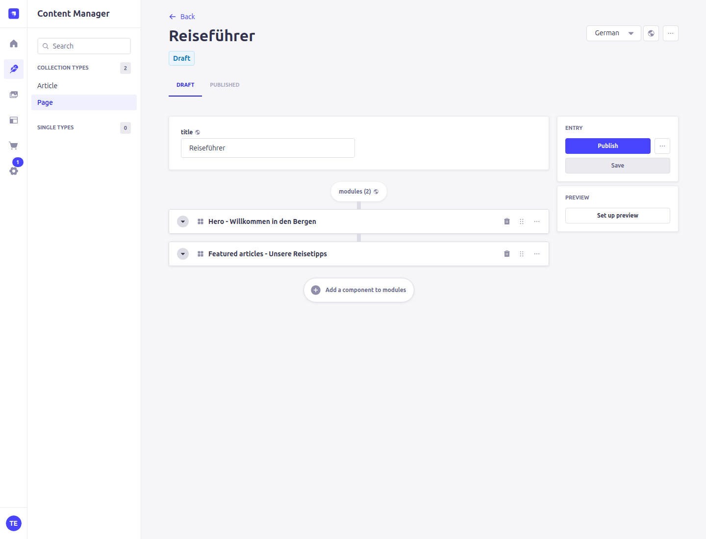
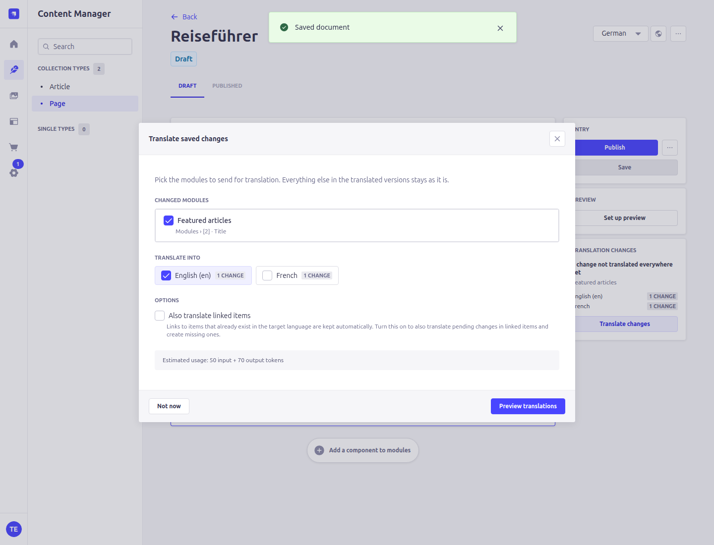
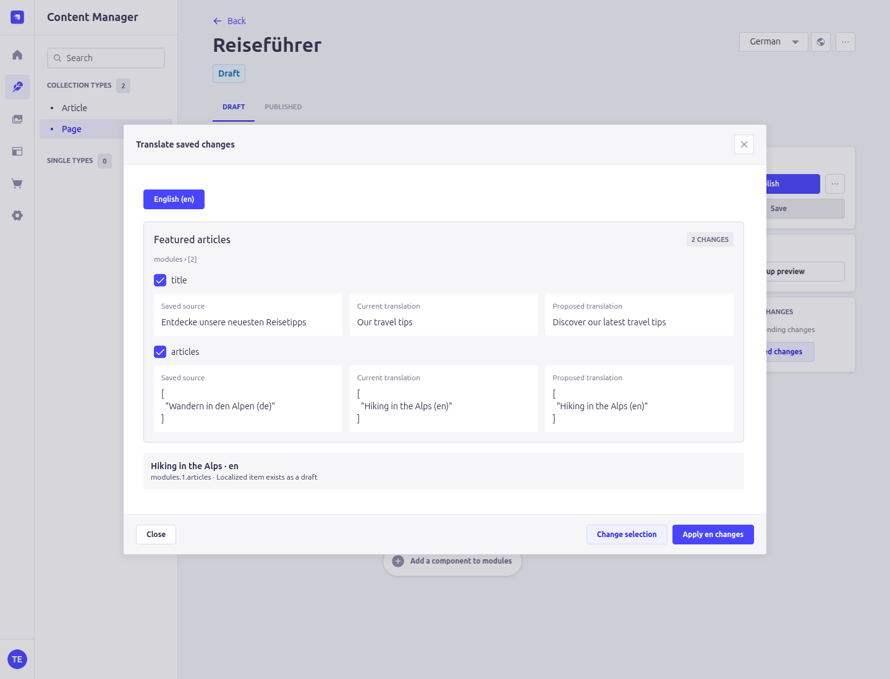
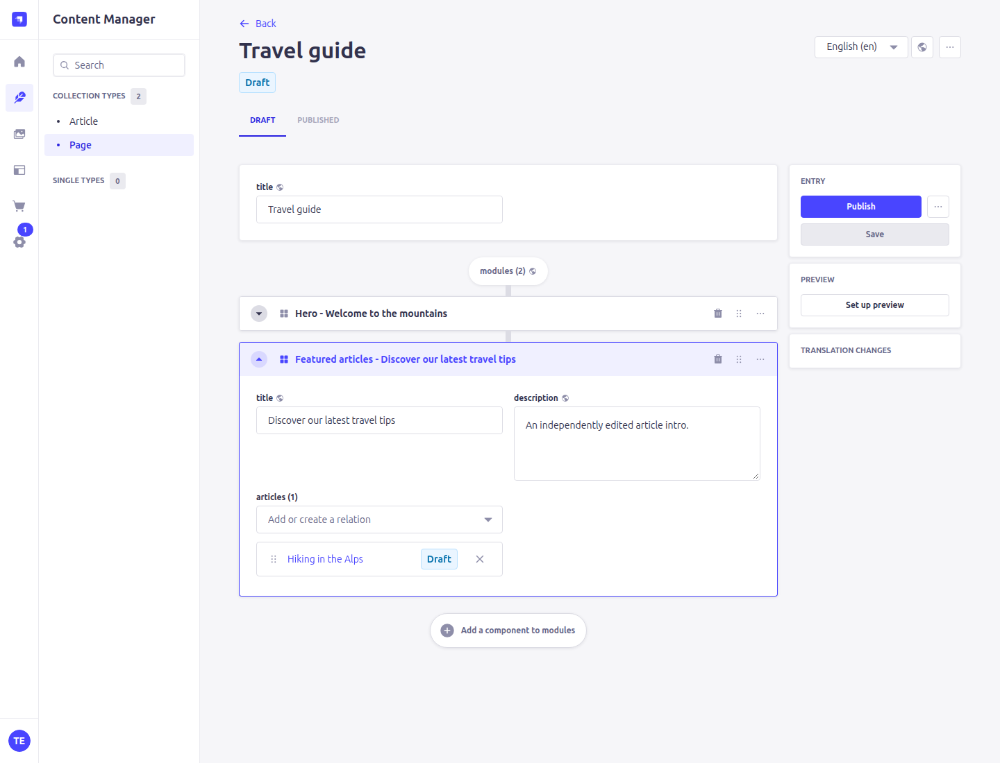
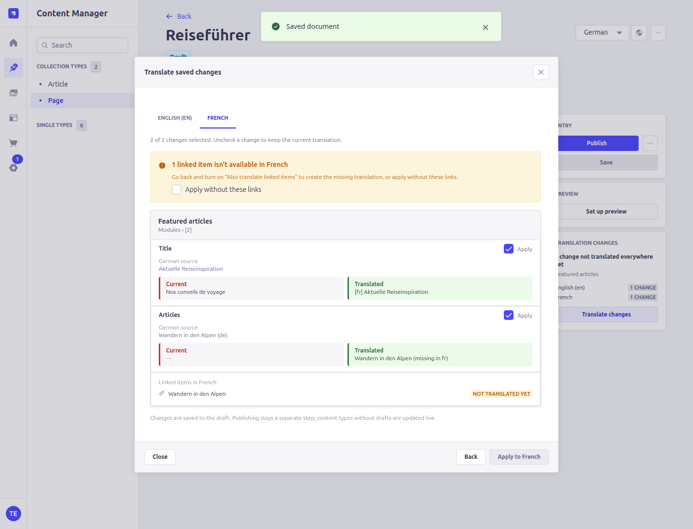
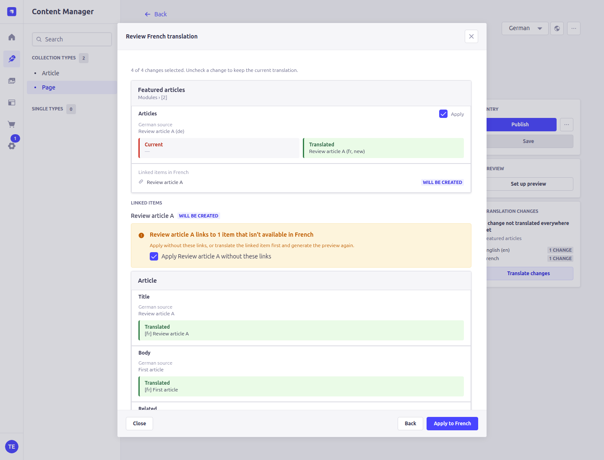
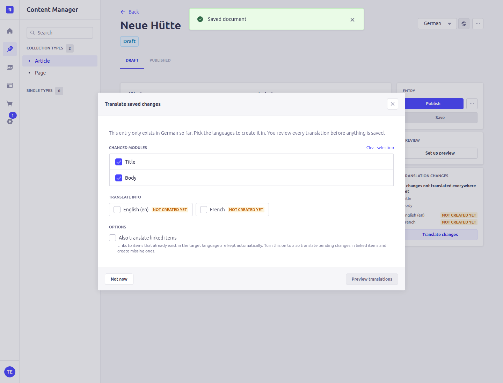
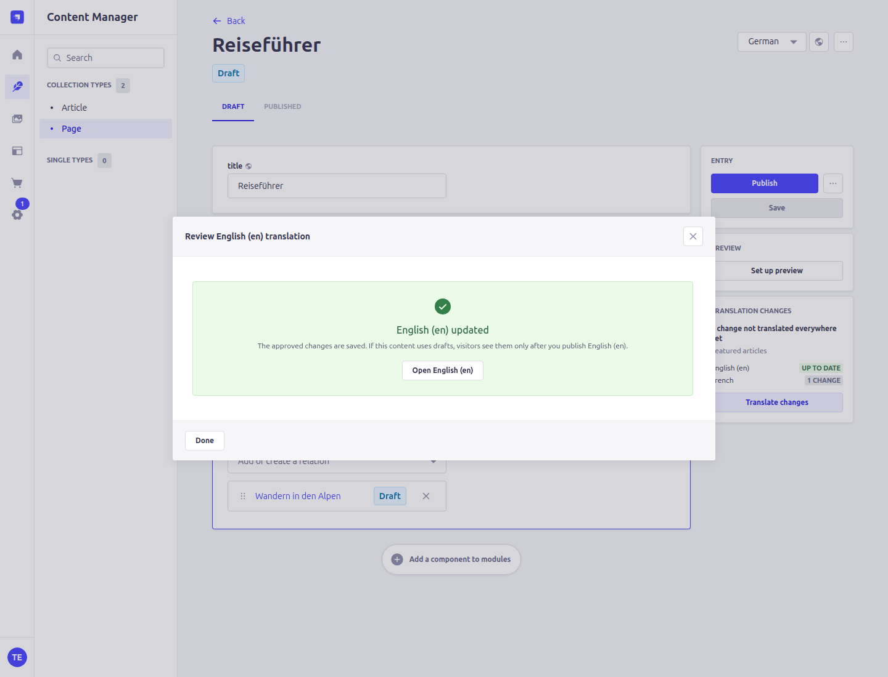
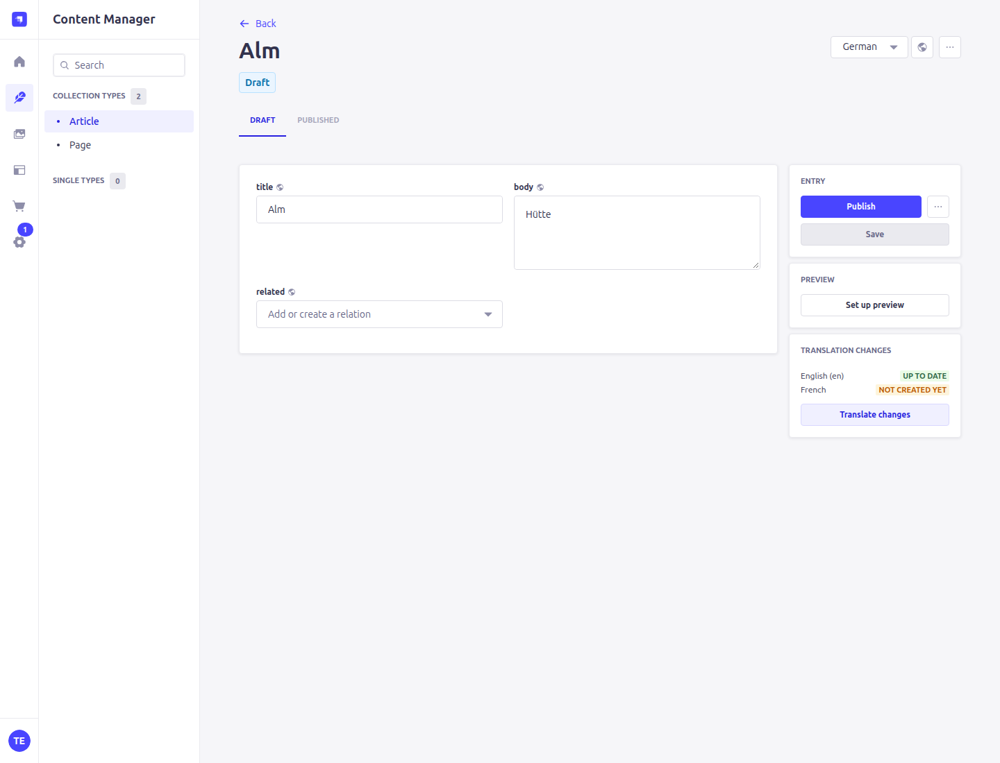
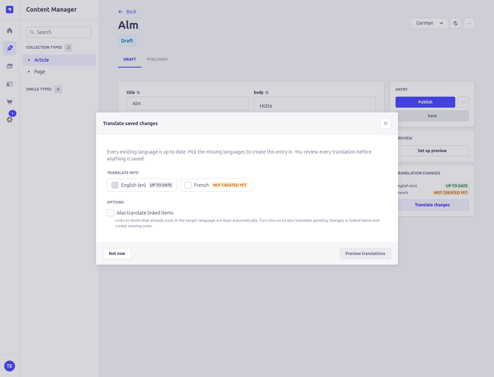

<details>
<summary>Mobile language selection and module preview</summary>

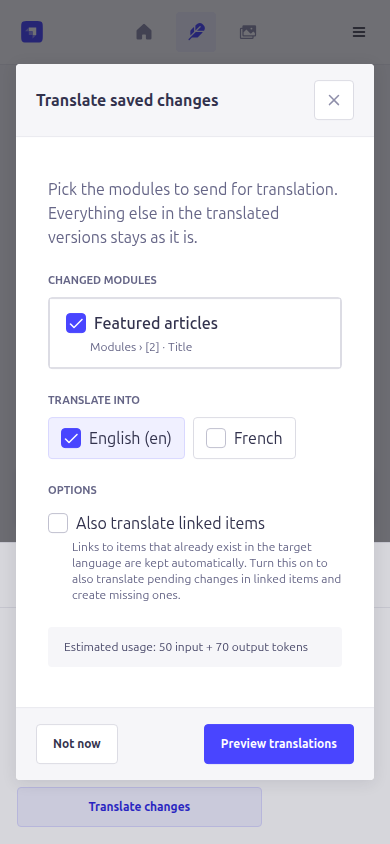
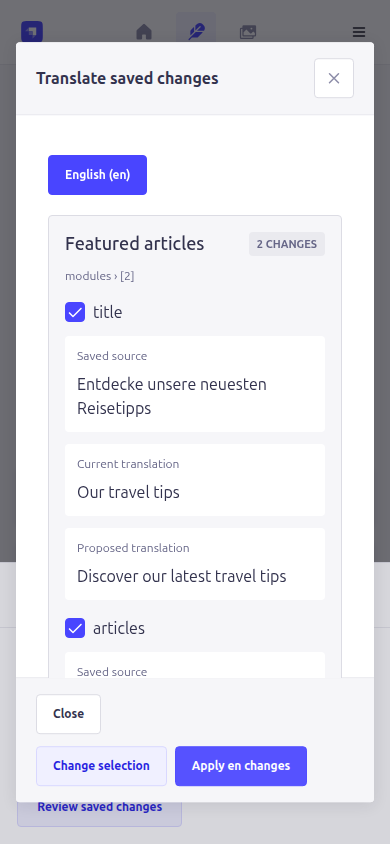

</details>

## Preview / review before save

Pass `Preview translation` from the document action modal to stage a translation. The plugin runs the full pipeline but stops before the upsert; the proposed payload + a structural diff are returned for an editor to accept or discard. Previews TTL after 1 hour.

## Provider registry

The plugin ships with the `openrouter` provider. To add another (DeepL, Anthropic direct, Google Translate, etc.) implement the contract in `docs/PROVIDER.md` and call:

```js
const providers = require("strapi-plugin-translate/server/providers");
providers.register("your-provider", require("./your-provider"));
```

## Testing

```
npm test          # vitest
npm run verify    # plugin loads + tests
npm run typecheck # tsc --noEmit (JSDoc-level)
npm run test:integration # build, then exercise real Strapi + SQLite
```

The integration fixtures test component identity (including independently ordered nested children), localized nested relations, pending-language state, idempotent and concurrent acceptance, stale previews, metadata recovery, linked-item updates, and automatic propagation. They also exercise the real controllers with locale/field-restricted Strapi abilities, initial creation by ordinary editors, and separate optional-link approval for children. Development integration checks use Node 24 and `better-sqlite3`; no production dependency is added.

To reproduce admin checks and screenshots:

```sh
npm run build
npm run fixture -- build /tmp/translate-strapi-fixture
TRANSLATE_FIXTURE_PORT=1348 npm run fixture -- start /tmp/translate-strapi-fixture
# In another terminal; CHROME_PATH can override /usr/bin/google-chrome:
npm run test:browser
```

The disposable fixture account is `translate-fixture@example.test` / `FixtureOnly123!`. This fixture creates only local sample data, uses a fake translation provider, and is not intended for deployment. Use a fresh fixture directory for a repeatable browser test. The HTML proposal is in [docs/plugin-improvement-plan.html](docs/plugin-improvement-plan.html).

## License

MIT
